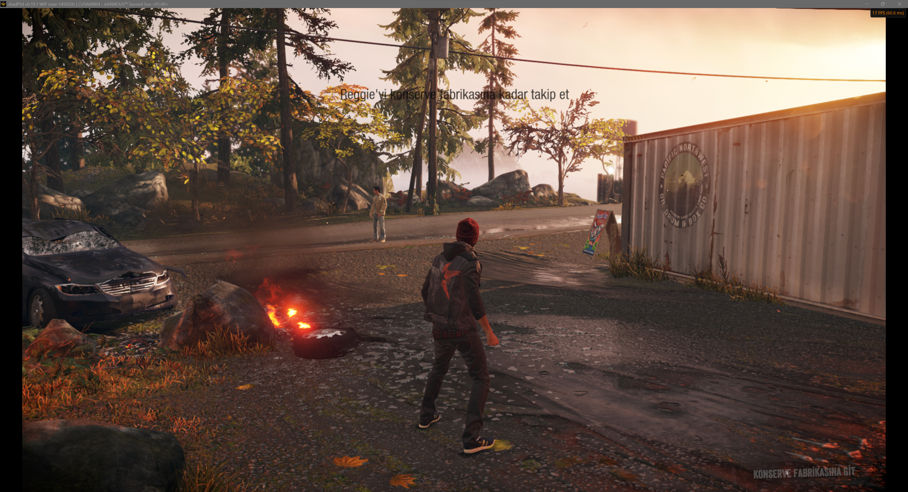
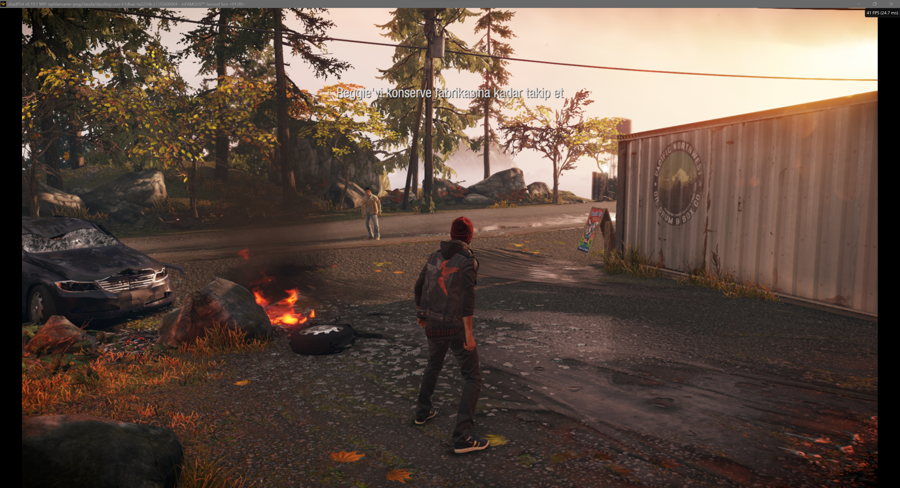

<!--
SPDX-FileCopyrightText: 2026 shadPS4 Emulator Project
SPDX-License-Identifier: GPL-2.0-or-later
-->

<h1 align="center">
  <br>
  <a href="https://github.com/MeWeGo/infamous-pc"></a>
  <br>
  <b>infamous-pc — inFAMOUS High-FPS Custom Build</b>
  <br>
</h1>

<h1 align="center">
  <a href="https://discord.gg/bFJxfftGW6">
         
  <a href="https://github.com/MeWeGo/infamous-pc/releases/latest">
         
  <a href="https://github.com/MeWeGo/infamous-pc/stargazers">
         
</h1>

# infamous-pc — inFAMOUS High-FPS Custom Build

> Fork of [shadPS4](https://github.com/shadps4-emu/shadPS4) (via [rayhlancaner-png/shadPS4-Infamous-FixBuild](https://github.com/rayhlancaner-png/shadPS4-Infamous-FixBuild)) focused on **inFAMOUS Second Son** (CUSA00223) and **inFAMOUS First Light** at high framerates, with graphics fixes and color corrections.

- **Custom build developers:** Eye Of The Ruins, 0xDeftones
- **Default branch:** `claude/dazzling-cori-h1dhwi`

> [!NOTE]
> Bugs and glitches may remain. The goal of this build is maximum performance on inFAMOUS.
> First-time stutter is expected while shaders compile; it smooths out as the shader cache fills. Do not delete the shader cache.

## What is included

Merged parent work (1.0.10–1.0.16 line, 51 commits) **plus** this fork's 30 commits:

- **Performance:** second compute queue / async compute path (`SHADPS4_ASYNC_COMPUTE=1` to enable, `=0` kill-switch), upload worker off the GPU thread, gigabyte uploads in parts, deferred readback (only the waiting thread waits), narrower draw barriers, recorder-thread descriptor sets, texture/binding fast paths.
- **Stability / VRAM:** retry residency allocation on OOM with memory-use logging, allocate past budget instead of failing, pageable device-local memory, retry pipeline creation when the driver fails, persistent driver `VkPipelineCache`.
- **Shaders:** BP01–BP12 backports, wave64 ballot lowering with exhaustive order-independent uniformity check (`ReachesLaneVaryingSource`), shared-memory (LDS) barriers, SDWA compare + unnormalized-sampler fixes, shader patches applied to cached shaders, compute pipeline async build.
- **Input:** gamepad touchpad swipes, stick-driven touchpad fingers (L3/R3), touchpad finger-activity logging, GPU draw timing.
- **Tuning without rebuild:** `SHAD_*` env vars (see below) + `infamous-tuning.patch`.

### Performance comparison

**Test system:** AMD Ryzen 9 7950X, NVIDIA GeForce RTX 4090

| Before (main) | After (custom build) |
| :-----------: | :------------------: |
|  |  |

## Recommended settings

- **FSR:** OFF — causes graphical corruption in inFAMOUS.
- **Debug → Readbacks:** `Precise`.
- **Debug → Direct Memory Access:** ON.
- **Debug → Shader Cache:** ON.
- **Vblank Frequency:** set to your target framerate.

### 4 GB VRAM

This build includes the VRAM pressure fixes (release old textures, retry instead of closing, part-wise uploads, e.g. save loads). If you still hit issues on 4 GB cards:

- Keep Shader Cache ON, close other GPU apps.
- Keep the shader cache (`%APPDATA%\shadPS4\cache\<CUSA>`); first sight of a new effect (new power) stutters once, then loads at startup.

## Tuning knobs (no rebuild)

| Variable | Default | Effect |
| --- | --- | --- |
| `SHADPS4_ASYNC_COMPUTE` | off | `1` routes eligible compute to second queue, `0` force off |
| `SHAD_READBACK_WINDOW_KB` | 512 (this fork: 1024) | GPU readback window size |
| `SHAD_HOT_WINDOW_SECS` | 5 | How long read-back memory is copied ahead |
| `SHAD_PREFETCH_BACKOFF_MAX` | 7 | Stale-window backoff |
| `SHAD_PREFETCH_OFF` | 0 | `1` disables readback prefetch |
| `SHAD_AHEAD_MINRUN` / `SHAD_AHEAD_MAX` / `SHAD_AHEAD_BASE` | 2 / 16 / 4 | Page-invalidation lookahead (`MAX=64` restores wide scan) |

Example (Windows `cmd`): `set SHAD_READBACK_WINDOW_KB=1024 && shadps4.exe -g CUSA00223`

## Controls

- Xbox / DualShock / DualSense work out of the box.
- Touchpad: gamepad swipe + L3/R3 stick-driven fingers; two-finger swipes supported.
- Keyboard fallback: see in-app Controller settings (per-game bindings, up to 3 keys per action).

| Button | Function |
| --- | --- |
| F10 | FPS counter |
| F11 | Fullscreen |
| F12 | RenderDoc capture (or screenshot) |

## Building

```sh
git clone --recursive https://github.com/MeWeGo/infamous-pc.git
cmake -S . -B build -G Ninja -DCMAKE_BUILD_TYPE=Release
cmake --build build
```

Docs: [Windows](./documents/building-windows.md) · [Linux](./documents/building-linux.md) · [macOS](./documents/building-macos.md) · [Docker](./documents/building-docker.md) · [Debugging](./documents/Debugging/Debugging.md)

Upstream help: [Quickstart](https://github.com/shadps4-emu/shadPS4/wiki/I.-Quick-start-%5BUsers%5D) · [Compatibility](https://github.com/shadps4-compatibility/shadps4-game-compatibility)

## Running inFAMOUS

```sh
shadps4.exe --show-fps -g "<path-to>\CUSA00223-merged\eboot.bin"
```

- You must dump the game and firmware (`sys_modules`) from your own PS4. No game files are included.
- First boot compiles shaders — expect stutter, then smoother play.

## Tests

```sh
cmake -S . -B build -DENABLE_TESTS=ON
cmake --build build --target shadps4_gcn_test shadps4_settings_test
./build/tests/shadps4_gcn_test --gtest_filter='Wave64*'
```

Covers `ReachesLaneVaryingSource` order-independence, wave64 reduction folding, and subgroup vs workgroup barriers.

## Credits

### Custom build
- **Eye Of The Ruins, 0xDeftones**
- Parent build: [rayhlancaner-png](https://github.com/rayhlancaner-png/shadPS4-Infamous-FixBuild), TOXIC-KID (#6 4 GB OOM fix)

### Upstream shadPS4
- [georgemoralis](https://github.com/georgemoralis) · [psucien](https://github.com/psucien) · [viniciuslrangel](https://github.com/viniciuslrangel) · [roamic](https://github.com/roamic) · [squidbus](https://github.com/squidbus) · [frodo](https://github.com/baggins183) · [Stephen Miller](https://github.com/StevenMiller123) · [kalaposfos13](https://github.com/kalaposfos13)
- Logo by [Xphalnos](https://github.com/Xphalnos)

<a href="https://github.com/MeWeGo/infamous-pc/graphs/contributors">
  
</a>

## License

- [GPL-2.0](https://github.com/MeWeGo/infamous-pc/blob/main/LICENSE)
- Upstream: [shadps4-emu/shadPS4](https://github.com/shadps4-emu/shadPS4)
